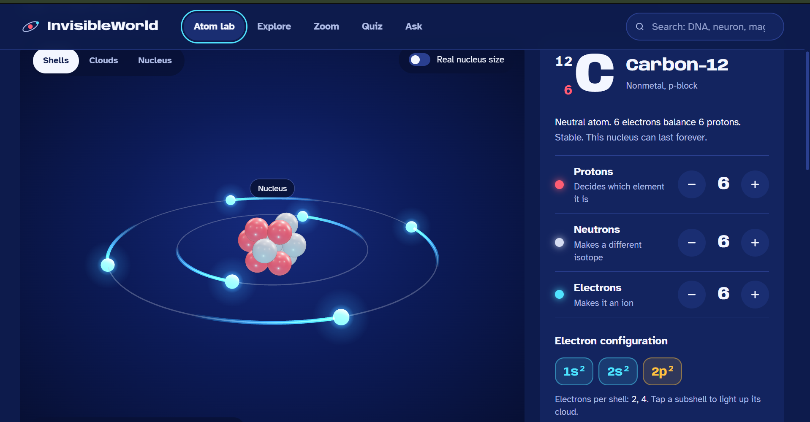
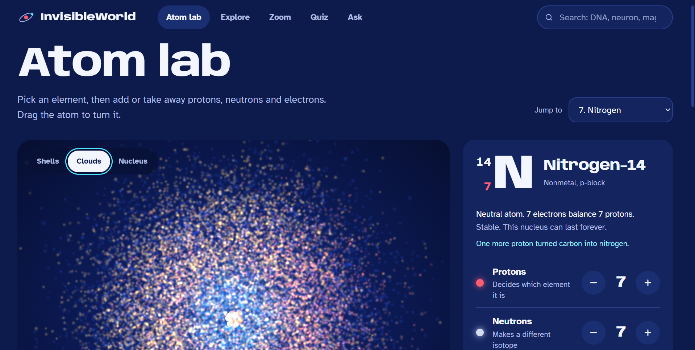

# InvisibleWorld

**See the things your eyes can't.** InvisibleWorld is an interactive science website for students. Build an atom in 3D, look at its electron clouds, and zoom from a human hair all the way down to a nucleus.

**Try it live: [invisible-world-seven.vercel.app](https://invisible-world-seven.vercel.app)**

Jump straight to the [Atom lab](https://invisible-world-seven.vercel.app/atom).

## Screenshots

### Build an atom
Pick an element and add or remove protons, neutrons and electrons. The shell view shows electrons orbiting the nucleus.



### See the electron clouds
The cloud view shows where electrons are most likely to be, the way quantum physics describes them.



## What you can do

- **Atom lab:** build any of the first 36 elements and see it as shells, as electron clouds, or as a close-up of its nucleus.
- **Make light:** make an electron jump and see the colour of light the element gives out.
- **Zoom:** slide from human size down to a single atom.
- **Explore:** bacteria, viruses, DNA, magnetic fields and neurons.
- **Quiz:** guess the mystery object from a drawing and a clue.
- **Ask:** ask the science guide a question.

## Run it on your computer

```bash
npm install
npm run dev
```

Then open http://localhost:5173.

The Ask page can use a live AI model through the optional backend. Without it, the guide answers from the site's own notes.

```bash
cd backend
python -m venv .venv
.venv\Scripts\activate
pip install -r requirements.txt
copy .env.example .env
uvicorn main:app --reload --port 8000
```

Put `GEMINI_API_KEY` or `OPENAI_API_KEY` in `backend/.env` only. Never commit that file.

## Put it online

The live site is hosted on Vercel at https://invisible-world-seven.vercel.app. Every push to `main` updates it automatically.

To host your own copy, use [Vercel](https://vercel.com). It's free, and the website is a static site:

1. Sign in to Vercel with GitHub and click **Add New → Project**.
2. Import this repository. If Vercel lists two parts, choose **Import single project** on the **app** (Vite) row. Keep the defaults: build command `npm run build`, output folder `dist`.
3. Click **Deploy**.

`vercel.json` makes page links like `/atom` work when they are opened directly.

## Built with

React, Tailwind CSS, Framer Motion, Three.js with React Three Fiber, and FastAPI. The design system is described in [DESIGN.md](DESIGN.md).

---

<p align="center">Made with ❤️ by Bharani Sankar</p>
